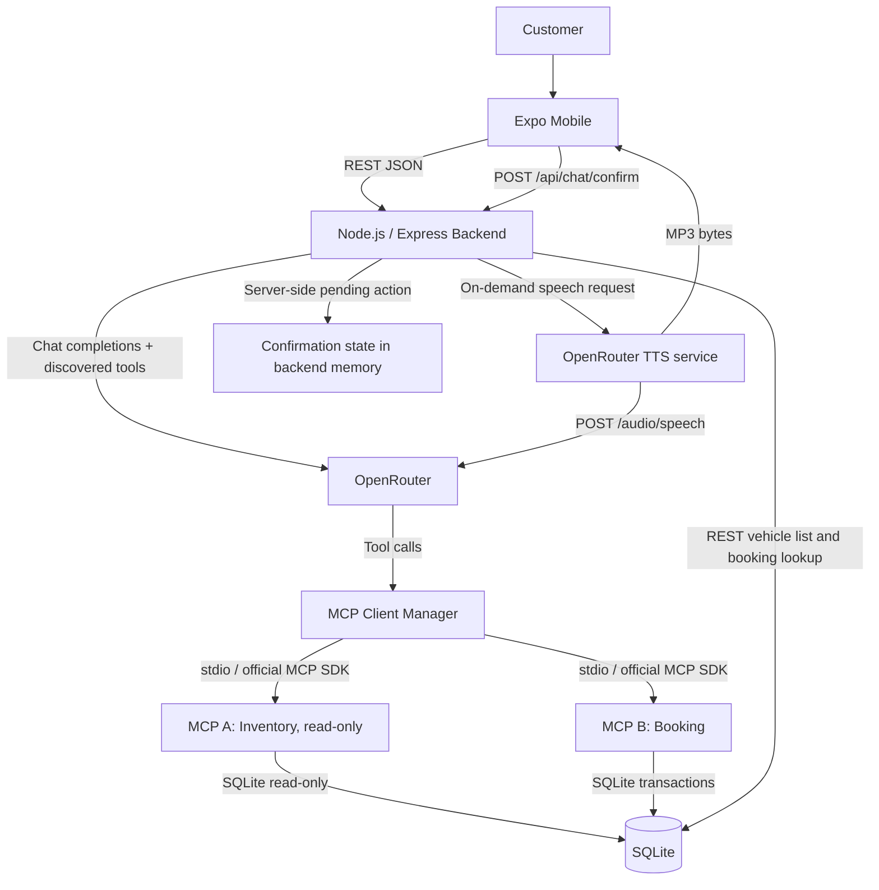

# Arsitektur Easy Rent Bali – AI Assistant

## Gambaran sistem



Komunikasi chat tool-call menggunakan MCP sungguhan. MCP A dan MCP B dijalankan
sebagai proses terpisah memakai stdio transport dari official
`@modelcontextprotocol/sdk`. Endpoint REST `GET /api/vehicles` dan
`GET /api/bookings/:reference` menggunakan repository SQLite backend untuk
query baca; booking writes hanya dilakukan MCP B.

## Frontend

`apps/mobile` adalah aplikasi React Native/Expo TypeScript dengan tema warna
Easy Rent Bali dan komponen chat, vehicle card, detail, booking summary, status,
serta bottom navigation. API client bertipe menggunakan `EXPO_PUBLIC_API_URL`.
Conversation ID dan pesan mobile disimpan lokal menggunakan AsyncStorage.

UI saat ini mencakup splash, chat, detail kendaraan, lookup booking, dan
pengaturan. Kartu kendaraan tampil jika backend memberikan hasil terstruktur.
Booking dimulai dan dikonfirmasi melalui percakapan/dialog; **form booking,
review, dan success screen terpisah seperti yang diminta PRD tidak tersedia di
alur UI produksi saat ini**. Verifikasi aktual dilakukan di Expo Web; Android
fisik/emulator belum diuji.

## Backend

`backend/src/index.ts` membangun Express API, menjalankan migrasi SQLite,
memasang middleware validasi, CORS, batas body, timeout, rate limit, logging,
dan error handling. Chat disimpan ke tabel `conversations` dan `messages`.

`OpenRouterService` mengirim history percakapan dan tool definitions yang
didiscover dari MCP manager. Tool loop memiliki batas iterasi. `McpClientManager`
menjaga ownership map, menghubungkan proses MCP, membatasi waktu eksekusi, dan
meneruskan hasil terstruktur.

### Booking confirmation gate

Ketika model meminta write tool, backend menahan eksekusi dan membuat pending
action dengan conversation ID, argumen, fingerprint, ringkasan, dan TTL 10 menit.
Pesan chat biasa tidak mengonfirmasi action itu. Mobile mengirim keputusan
melalui `POST /api/chat/confirm`; backend mengambil pending state sendiri,
mengonsumsi action, lalu menjalankan tool MCP B atau membatalkannya.

Pending action saat ini berada di memori satu proses, bukan tabel SQLite.
Karena itu backend harus dijalankan satu replika; action pending hilang saat
restart. Gunakan persistent SQLite volume untuk database, tetapi jangan
menganggapnya turut mempersistenkan pending confirmation.

## OpenRouter

OpenRouter diakses melalui OpenAI-compatible SDK dan
`https://openrouter.ai/api/v1`. `OPENROUTER_API_KEY`, `OPENROUTER_MODEL`,
`OPENROUTER_SITE_URL`, dan `OPENROUTER_APP_NAME` diatur server-side dari
environment. Credential tidak diteruskan ke aplikasi mobile.

Chat live sebelumnya berhasil menjalankan completion dan temporary tool call.
Completion terbaru pada pemeriksaan QA menerima HTTP 429; health endpoint hanya
menilai konfigurasi/reachability, bukan kuota completion. Detail model dan
troubleshooting terdapat di [LLM_SETUP.md](./LLM_SETUP.md).

### Qwen3 TTS 1.7B

Fitur “Dengarkan” meminta suara hanya setelah pengguna menekan tombol pada balasan.
Backend memanggil OpenRouter `POST /api/v1/audio/speech` menggunakan
`OPENROUTER_TTS_MODEL=qwen/qwen3-tts-1.7b` dan key OpenRouter server-side yang
sama dengan chat. Backend mengembalikan MP3 mentah; Expo memutar audio dan
menyimpan sementara di cache perangkat native. Audio tidak otomatis dibuat atau
disimpan di database. Request teks dibatasi 2000 karakter dan endpoint speech
dibatasi enam permintaan per menit per client IP.

OpenRouter menyebut model ini menerima teks dan menghasilkan speech, dengan
provider Together; ini endpoint terpisah dari chat completions dan tidak
menjalankan MCP. Daftar bahasa resmi yang ditemukan tidak mencantumkan Bahasa
Indonesia, sehingga kualitas pelafalan bahasa Indonesia belum diverifikasi.
TTS live belum dites; penggunaan endpoint dapat menimbulkan biaya. Detail ada
di [LLM_SETUP.md](./LLM_SETUP.md).

## MCP Server A — Inventory

`easy-rent-inventory-server` menyediakan:

- `search_vehicles`
- `get_vehicle_details`
- `check_vehicle_availability`

Server membuka SQLite read-only dan `query_only=ON`. Availability mengecek booking
aktif berstatus `PENDING` dan `CONFIRMED`; field `availability_status` sendiri
bukan sumber tunggal status ketersediaan. Production tidak seed data contoh
secara default.

## MCP Server B — Booking

`easy-rent-booking-server` menyediakan:

- `create_booking`
- `get_booking`
- `update_booking`
- `cancel_booking`

Semua input divalidasi dan statement SQL diparameterisasi. Create/update/cancel
menggunakan transaksi. Periode tumpang tindih ditolak; hanya booking `PENDING`
yang dapat diperbarui atau dibatalkan. Cancel menyimpan status/history dan tidak
menghapus record.

Skema input/output lengkap ada di [MCP_INTEGRATION.md](./MCP_INTEGRATION.md).

## Database

Database menggunakan SQLite `better-sqlite3`, migration berada di
`backend/src/database/migrations/001_initial.sql`.

```text
vehicles ──┐
           ├── bookings (vehicle_id → vehicles.id)
           │
conversations (conversation_id UNIQUE)
      └── messages (conversation_id → conversations.conversation_id)
```

Tabel `vehicles` memuat deskripsi, spesifikasi, harga, fitur, dan status.
`bookings` menyimpan referensi unik, data pelanggan, periode, lokasi, estimasi,
status dan timestamps. `messages` memiliki foreign key ke conversation; index
mendukung pencarian kendaraan, overlap booking, status, dan riwayat message.
Detail kolom terdapat di migration dan appendix status PRD.

Development menjalankan delapan kendaraan contoh. Production tidak melakukan
seed sample secara default dan hanya mengembalikan record yang telah dimuat
operator; sample data tidak boleh dipakai sebagai armada aktual.

## Operasi dan batasan deployment

- SQLite production memerlukan persistent volume, misalnya mount `/data` dan
  `DATABASE_URL=file:/data/easy-rent-bali.db`; ephemeral filesystem tidak aman.
- Jalankan satu backend replica karena pending action masih process-local.
- Speech API berpotensi menimbulkan biaya dan tidak memiliki autentikasi pengguna
  tersendiri saat ini; jangan membukanya ke publik tanpa kontrol akses/spend limit.
- Deployment publik, persistent cloud volume, APK, dan QR perangkat belum
  diverifikasi atau dilakukan.
- Conversation berisi data pelanggan harus mempunyai kebijakan akses, retention,
  backup, dan restore sebelum penggunaan operasional.
- Lihat [DEPLOYMENT_REPORT.md](./DEPLOYMENT_REPORT.md) dan
  [TESTING_REPORT.md](./TESTING_REPORT.md) untuk status bukti.
